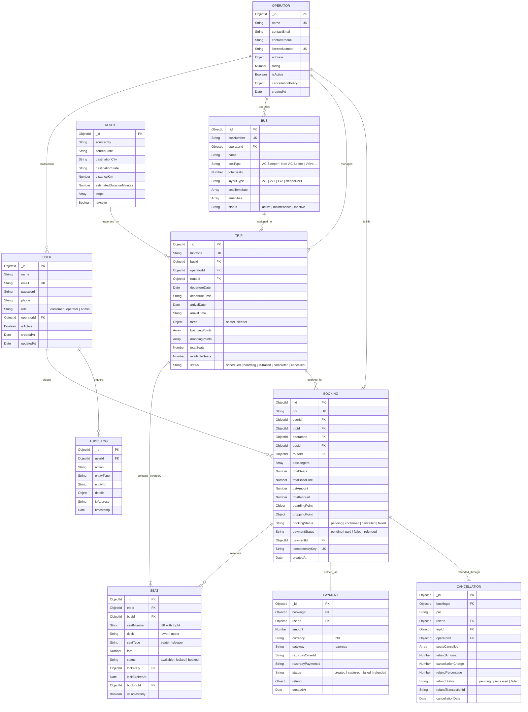

# 📊 Database Design & Entity Relationship (ER) Documentation

**ALGIONS AI LABS PRIVATE LIMITED – Bus Booking Management System**  
**Phase 2: Database Design & Schemas**

---

## 1. Entity-Relationship Diagram (Mermaid)

---

## 2. Key Data Integrity Guarantees

### A. Duplicate Booking Prevention (Acceptance Test 2)
1. **Compound Unique Index**: `Seat.index({ tripId: 1, seatNumber: 1 }, { unique: true })`
   - Even in simultaneous booking attempts, MongoDB rejects duplicate insertions.
2. **Atomic Conditional Updates / Transactions**:
   - Seat locking or booking performs `Seat.findOneAndUpdate({ tripId, seatNumber, status: 'available' }, { status: 'locked', lockedBy, lockExpiresAt })`.
   - If two requests collide for the same seat, exactly one succeeds and the other receives an HTTP 409 Conflict error.

### B. Unique PNR and Financial Idempotency
- **Unique PNR**: `Booking.index({ pnr: 1 }, { unique: true })`.
- **Idempotency Key**: Prevents double-charging or duplicate bookings during retried network requests.

### C. Scalable Search & Query Indexes
- `Trip.index({ routeId: 1, departureDate: 1, status: 1 })`
- `Route.index({ sourceCity: 1, destinationCity: 1, isActive: 1 })`
- `Booking.index({ userId: 1, createdAt: -1 })`
- `Seat.index({ tripId: 1, status: 1 })`
- `Seat.index({ lockExpiresAt: 1 })` (for automatic lock expiration)
